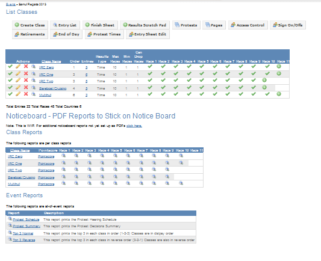
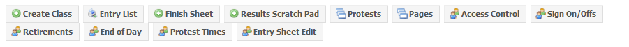
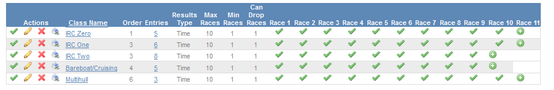
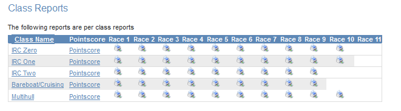
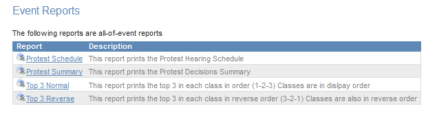

## Overview

The following picture shows the Class Dashboard. This is the main page used by Scorers and Recorders. All key functions are available from this page. Depending on your access rights, some of these functions may not be available.

The class dashboard is divided into 4 areas as follows.

## Event Functions

These functions are not class specific but event wide function. Only those functions to which you have been granted access will appear. The functions are:

### Create Class

Adds a new class to the event and to the Class Control Panel. See [Add New Class](add-new-class.html "Add New Class (page does not exist)") For more details.

### Entry List

Creates an event wide entry list for printing.

### Finish Sheet

Accesses the event wide finish sheet function. See [Entering Results](entering-results.html "Entering Results") For more details.

### Results Scratch Pad

Accesses the event wide results scratch sheet pad function. See [Entering Results](entering-results.html "Entering Results") For more details.

### Protests

Access the Protests Subsystem. See [Protests Subsystem](protests-subsystem.html "Protests Subsystem (page does not exist)") For more details.

### Pages

Access the Pages Subsystem. See [Pages Subsystem](pages-subsystem.html "Pages Subsystem (page does not exist)") For more details.

### Access Control

Access the Access Control Subsystem. This funciton is only available to Administrators. See [For Administrators](for-administrators.html "For Administrators (page does not exist)") For more details.

### Sign On/Off

Access the Sign On/Off Subsystem. See [Sign On/Off Subsystem](sign-on-off-subsystem.html "Sign On/Off Subsystem (page does not exist)") For more details.

### Retirements

Access the Retirements Subsystem. See [Retirements Subsystem](retirements-subsystem.html "Retirements Subsystem (page does not exist)") For more details.

### End of Day

Access the End of Day processing function. See [End Of Day Processing](end-of-day-processing.html "End Of Day Processing (page does not exist)") For more details.

### Protest Times

Allows you to calculate and modify the published protest time limits for ech day. See [Protest Time Limits](protest-time-limits.html "Protest Time Limits (page does not exist)") For more details.

### Entry Sheet Edit

Edits the event wide entry sheet for mass changes. See [Entry Management](entry-management.html "Entry Management (page does not exist)") For more details.

## Class ControlPanel

The Class Control Panel is the most used area of the system. Most of the functions Scorers and recorders do start with this panel. each class is listed on a single line. The function that will be used, in typical order of importance are:

### Create New Race

To create a new race for a class, click the  icon. This will create a new race into which you can [Enter Results](enter-results.html "Enter Results (page does not exist)"). The  icon will create the "next" race. That is, if the icon is in the Race 10 column, then Race 10 will be created and the icon will move to the Race 11 column.

### Access a Race and Race Status

To access a race either to update the race properties or enter finish times or finish places, click the  icon for the race you need to access. For example, the  icon in the Race 8 column will allow you to access race 8 for this class. Note that the icon will change depending on the status of the race. Possible race statuses are:

  -  Published. results for this race will be available on the internet.
  -  Planning. Results for this race will not be available on the internet. This is typically used when you want to enter results before publishing them.

### See Internet Results

Each Class Name is a hyperlink to the results as displayed on the internet. Clicking this hyperlink will open a new browser tab with the results displayed as they would be seen by an internet user.

### Class Action Icons

The icons to the left of the class name have the following functions:

  -  - Class Status. This has the status function as for Events and races. If the status is not  the results for this class will not be displayed.
  -  - Edit Class Properties. See [Create Class](create-class.html "Create Class (page does not exist)") for more details on the class properties. Note that the number of drops and protest time limits are contained in the Class Properties.
  -  - Delete a class and all the entries and results for this class. Be very sure you know what you are doing. This process is not reversible.
  -  - Print a PDF version of the Class Series results.

### Class Information

  - Order - This is the order in which the class results will be displayed on the internet.
  - Entries - Ths is the current number of entries for this class. Note that it is hyperlinked. Clicking the entries value will take to you the editable entry list for this class.
  - Results type -This is either "Time" or "Place". Time results are used where the finish time is used for handicapping. Place is used where it is only required to record the order in which the boats finished (in most one design classes for example).
  - Max races - The maximum number of races to be sailed by this class.
  - Min races - The minimum number of races to be sailed by this class before any drops are allowed.

## Class Reports

## Event Reports

-----

Quick Links:
[Recorders Home Page](for-recorders.html "For Recorders") [Scorers Home Page](for-scorers.html "For Scorers")
