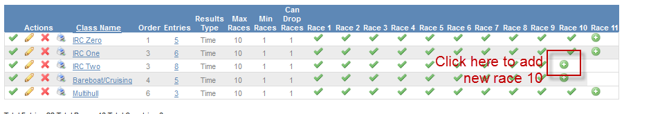
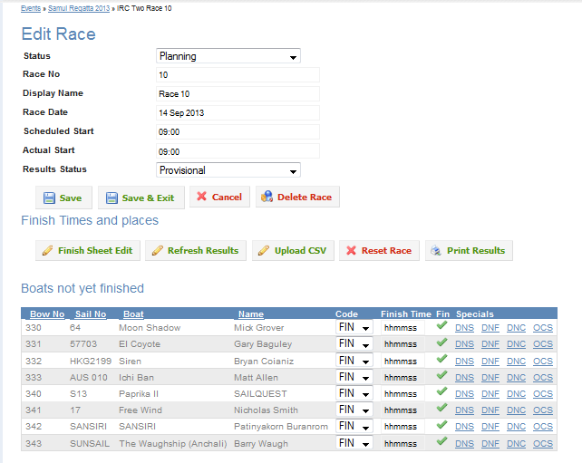

## Overview

To add a new race for a class, click the  icon. If the  icon is in the Race 10 column, this will create a new Race 10 and the  icon will move to the Race 11 column.

The system wil then take you to the edita race page. A new race 10 will be created.

## Race Properties

The system will add default values for most fields. Enter the correct values for the race properties and then click Save. The properties are:

<table>
<colgroup>
<col style="width: 25%" />
<col style="width: 25%" />
<col style="width: 25%" />
<col style="width: 25%" />
</colgroup>
<thead>
<tr class="header">
<th>Field</th>
<th>Type</th>
<th>Description</th>
<th>Default Value</th>
</tr>
</thead>
<tbody>
<tr class="odd">
<td>Status</td>
<td>Select List</td>
<td>Publish status of race.

To display results on internet select Published. To enter results without being published to internet select Planning.
</td>
<td>Planning</td>
</tr>
<tr class="even">
<td>Race No</td>
<td>Numeric</td>
<td>Race number</td>
<td>Increments by one from previous race</td>
</tr>
<tr class="odd">
<td>Display Name</td>
<td>Text</td>
<td>This is the title of the race in the results display. This could be "Race 10"

or "Cape Panwa Trophy Race" etc.
</td>
<td>Race n</td>
</tr>
<tr class="even">
<td>Race Date</td>
<td>Date</td>
<td>Actual date of race.</td>
<td>Today</td>
</tr>
<tr class="odd">
<td>Scheduled Start</td>
<td>Time hh:mm</td>
<td>Scheduled start time</td>
<td>09:00</td>
</tr>
<tr class="even">
<td>Actual Start</td>
<td>Time</td>
<td>Time that race was actually started</td>
<td>Scheduled Start</td>
</tr>
<tr class="odd">
<td>Results Status</td>
<td>Select List</td>
<td>Displays the results status as either Provisional or Final</td>
<td>Provisional

 

</td>
</tr>
</tbody>
</table>

-----

Quick Links: [Recorders Home](for-recorders.html "For Recorders") [Scorers Home](for-scorers.html "For Scorers")
